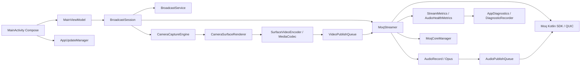

# MoQ Publisher 架構

## 目前資料流

## 元件責任

- `MainActivity` 負責 Compose 畫面、權限、設定與更新提示。它觀察 `MainViewModel` 的 `StateFlow`。
- `MainViewModel` 保存使用者設定、驗證開播參數，並把啟停請求交給 application-owned `BroadcastSession`。
- `BroadcastPreflight` 在開播前以 PASS、WARNING、ERROR 分級檢查權限、設備能力、Relay、網路、核心與裝置狀態，結果寫入 `MainViewModel` 的 diagnostics。
- `BroadcastSession` 管理直播 generation、相機、MoQ streamer、遠端驗證與前景服務的生命週期。舊 generation 的停止事件不能停止新直播。
- `BroadcastService` 在 Android 前景服務中持有相機／麥克風直播與短期續期 WakeLock，通知提供停止操作。
- `BroadcastService` 也觀察即時靜音狀態，背景通知會反映音訊是否已靜音。
- `CameraCaptureEngine` 管理 CameraX。`CameraSurfaceRenderer` 將相機紋理送到預覽與 MediaCodec input surface，避免在正常路徑複製 YUV。
- `SurfaceVideoEncoder` 和 `HardwareVideoEncoder` 封裝 MediaCodec。正常路徑使用 surface encoder，輸出在 callback 執行緒排入有上限的 `VideoPublishQueue`。
- `MoqStreamer` 擁有 MoQ session、重連、影片／音訊 publisher、時間戳、動態碼率與 relay 統計。相機及 AudioRecord callback 不直接執行阻塞的 MoQ 寫入。
- 音訊 capture worker 以每個 20 ms frame 的 ramp gain 套用增益，`AudioHealthMetrics` 在 capture thread 計算 RMS、dBFS、peak hold、聲道峰值與削波，UI 只讀取 `StateFlow`。
- `AudioInputDeviceRepository` 透過 `AudioManager` 列出可選輸入，`MoqStreamer` 對 `AudioDeviceCallback` 做拔除監控。選定設備消失時，AudioRecord 回退系統路由並由元件恢復協調器重建音訊 track。
- `BroadcastRecoveryCoordinator` 以元件為單位限制恢復次數並套用指數退避。`MoqStreamer` 可重建相機綁定、MediaCodec、影片發布 worker 或 AudioRecord，而不立即結束整場直播。
- `MoqCoreManager` 下載、驗證、選擇與快取官方相容的 native core。直播期間不替換正在使用的 native library。
- `AppDiagnostics`、`StreamMetrics` 與 `AudioHealthMetrics` 以受限事件歷史和每秒樣本記錄效能、傳輸、裝置與資源資訊。憑證在寫入前遮罩。

## 生命週期與執行緒

直播啟動時，Activity 建立不可變的 `BroadcastConfiguration`，`BroadcastSession` 增加 generation 並啟動 `BroadcastService`。Service 驗證權限、建立前景通知與 WakeLock 後呼叫 `startPending`。`MoqStreamer` 在 IO coroutine 建立 session，影片與音訊各自使用獨立 executor 和有上限 queue。

直播停止、Activity 銷毀、網路切換與 native exception 都會進入 streamer 的單一 cleanup 路徑。cleanup 先停止 publisher worker，再釋放 AudioRecord、MediaCodec、surface、MoQ producer、bandwidth 與 session。Service 只可用相同 generation 的停止命令停止直播。

## 已知邊界

`BroadcastLifecycleState` 以純 reducer 表達 `Preparing`、`Connecting`、`Announced`、`WaitingForSubscriber`、`Publishing`、`Reconnecting`、`Recovering`、`Failed` 與 `Stopping`，`MoqStreamer` 將它與 `StreamState`、診斷事件同步更新。`StreamHealthEvaluator` 每秒使用 `StreamMetrics`、`AudioHealthMetrics` 與影片 queue 媒體年齡評估相機、編碼、發布、音訊、FPS、queue 與 relay 狀態，`StreamAlertManager` 以冷卻與有上限歷史避免重複警報。健康通知會在主畫面顯示，警報事件會寫入 diagnostics。媒體恢復會先進入 `Recovering`，成功後依 subscriber demand 回到等待或發布狀態。

Relay 連線或本機 announce 不能代表 OBS 已接收或解碼，真實 OBS／Cloudflare 端對端驗證需要 Android 裝置與有效 Token。
