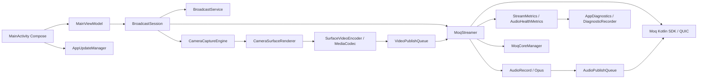

# MoQ Publisher 架構

## 目前資料流

## 元件責任

- `MainActivity` 負責 Compose 畫面、權限、設定與更新提示。它觀察 `MainViewModel` 的 `StateFlow`。
- `CloudflareProfilePanel` 只在獨立 Subscribe Token 與 Hang namespace 可用時產生觀看 QR Code，並提供 Browser Source／原生 MoQ 指引。QR Code 與複製操作都使用 Subscribe URL，不會把 Publish Token 放入觀看資訊。
- `MainViewModel` 保存使用者設定、驗證開播參數，並把啟停請求交給 application-owned `BroadcastSession`。
- `StreamPresetRepository` 將自訂畫質 Preset 與 Relay Profile 分開持久化。`StreamPresetPolicy` 驗證視訊和音訊參數，`MainViewModel` 套用後同步 CameraX。
- `BroadcastPreflight` 檢查權限、設備、Relay、網路、核心與裝置狀態。Android 未回報所選硬體 surface encoder 時，預檢記錄 WARNING 並允許啟動影片管線。
- `BroadcastSession` 管理直播 generation、相機、MoQ streamer、遠端驗證與前景服務的生命週期。舊 generation 的停止事件不能停止新直播。
- 直播中套用解析度與 FPS 時，`BroadcastSession` 先用 CameraX 建立候選來源。MediaCodec 重新設定後，新的影片 Track 首次寫入關鍵影格才完成變更。設定失敗或逾時時 CameraX 恢復先前選擇，音訊與 Relay 都維持其原本 Session。
- `BroadcastService` 在 Android 前景服務中持有相機／麥克風直播與短期續期 WakeLock，通知提供停止操作。
- `BroadcastService` 也觀察即時靜音狀態，背景通知會反映音訊是否已靜音。
- `CameraCaptureEngine` 管理 CameraX。`CameraSurfaceRenderer` 將相機紋理送到預覽與 MediaCodec input surface，避免在正常路徑複製 YUV。
- BroadcastService 在收到本場直播的投影同意結果後，先啟用 mediaProjection 前景服務類型，再由 ScreenCaptureEngine 取得投影。每份授權只建立一個 VirtualDisplay，畫面尺寸改變時調整原有顯示器。
- VirtualDisplay 接到共用 EGL renderer 的 SurfaceTexture。螢幕與相機沿用同一個編碼、影格節奏、時間戳和 MoQ 發布路徑。螢幕來源釋放後，相機開播的場次恢復 CameraX，螢幕開播的場次結束。Android 10 以上可在螢幕開播前選播放音訊並沿用現有 Opus 路徑。
- 推流並錄影時先啟用擷取，再連線 Relay。網路切換只重建 Relay 與上傳執行緒，保留 MediaCodec、AudioRecord、錄影 worker 與時間基準。只錄影使用相同的擷取和 MP4 路徑。
- 錄影 worker 在關鍵影格開始分段，編碼世代、尺寸、編碼參數及聲道改變時完成原段。它獨立管理 AAC 輸出、佇列、儲存空間及 MP4 封裝。完成並關閉封裝後才把檔案列為可匯出。
- 遠端存取由 BroadcastSession 啟用，在區域 IPv4 位址接受單一 TLS 用戶端。每次配對使用新的 Android Keystore 證書和隨機憑證。桌面程式先比對證書 SHA-256 才送憑證。手機可授權查看或控制，控制命令同時檢查配對授權與場次。撤銷或停止場次會關閉監聽與用戶端連線。
- 疊圖在背景產生位圖，靜態內容只在設定改變時更新，時鐘與計時每秒更新。EGL 執行緒上傳最新位圖並把同一紋理合成到預覽與編碼輸出。開啟疊圖時預覽顯示完整輸出構圖，觸控對焦依實際預覽位置換算。
- `SurfaceVideoEncoder` 和 `HardwareVideoEncoder` 封裝 MediaCodec。正常路徑使用 surface encoder，輸出在 callback 執行緒排入有上限的 `VideoPublishQueue`。
- `MoqStreamer` 擁有 MoQ session、重連、影片／音訊 publisher、時間戳、動態碼率與 relay 統計。相機及 AudioRecord callback 不直接執行阻塞的 MoQ 寫入。
- `LocalRecordingManager` 使用獨立 bounded queue 和 worker，沿用已編碼的 H.264／H.265 影像，另外以 AAC encoder 將 PCM 轉成 MP4 音訊。每個分段從關鍵影格開始，磁碟低於安全門檻或 MediaMuxer 失敗只停止錄影，並保留 MoQ 直播。
- 原生重連會丟棄影音佇列，保留直播時間基準，並在新關鍵影格成功寫入後更新 Relay 狀態。網路切換會在相同直播 generation 重新建立 Relay session。App 與前景通知皆讀取同一份 Relay 狀態。
- `VideoBitrateControl` 從目標碼率開始，以最低與最高設定限制 ABR。佇列深度或媒體年齡可在缺少容量估計時獨立觸發降碼率。直播設定與 ABR 操作經 `MoqStreamer` 的 video lock，MediaCodec 接受後才提交新碼率及設定。重連與影片編碼器重建沿用當場最後接受的碼率。
- 音訊 capture worker 以每個 20 ms frame 的 ramp gain 套用增益，`AudioHealthMetrics` 在 capture thread 計算 RMS、dBFS、peak hold、聲道峰值與削波，UI 只讀取 `StateFlow`。
- `AudioInputDeviceRepository` 透過 `AudioManager` 列出可選輸入，`MoqStreamer` 對 `AudioDeviceCallback` 做拔除監控。選定設備消失時，AudioRecord 回退系統路由並由元件恢復協調器重建音訊 track。
- `HardwareVideoEncoder` 與 `SurfaceVideoEncoder` 將實際 MediaCodec 名稱保存到 `StreamState.Live`，主畫面與每秒 diagnostics 都能區分實際硬體實作。動態碼率若被 codec 拒絕，ABR 會停用並保留最後有效碼率。
- `DeviceCapabilityRepository` 在 IO dispatcher 查詢 H.264／H.265 的硬體 encoder 名稱、surface input、寬高／FPS／碼率範圍與 CBR 能力。直播以選定 codec 與 FPS 嘗試啟動 MediaCodec，輸入尺寸採 CameraX 實際取得的畫面幾何。
- `DeviceHealthPolicy` 在熱度或記憶體壓力時產生降低碼率建議。主畫面的降低碼率按鈕套用約 25% 降幅，範圍限於當場直播且受最低碼率限制。
- 裝置健康樣本包含充電狀態、省電模式、App CPU 使用率及編碼 FPS。CPU 壓力同時參考 App 使用率和編碼 FPS。
- `BroadcastRecoveryCoordinator` 對元件採有限次數與指數退避。相同元件在 30 秒內重複失敗會延續重試額度。停止或網路切換時，`MoqStreamer` 先取消並等待恢復工作，再釋放編碼器與發布資源。
- `StreamHealthEvaluator` 以每秒活動時間樣本區分相機、GPU、編碼、影片發布、音訊擷取與音訊發布。低 FPS 必須連續十秒才發出警告，影片發布停滯則在有訂閱需求時判斷。
- `MoqCoreManager` 下載、驗證、選擇與快取官方相容的 native core。直播期間不替換正在使用的 native library。
- `offline` APK 由 Gradle 從官方 `moq-ffi` AAR 產生 ABI 分層 assets。`MoqCoreManager` 在啟動時把對應 asset 安裝到 app-private 目錄，執行相同 ELF、SHA-256 與 UniFFI symbol 驗證後才設定 library override。一般 release／compact APK 維持首次啟動下載流程。
- `AppDiagnostics`、`StreamMetrics` 與 `AudioHealthMetrics` 以受限事件歷史和每秒樣本記錄效能、傳輸、裝置與資源資訊。憑證在寫入前遮罩。
- `RelayProfileRepository` 透過 `ConnectionTokenStore` 保存 moq.pro 與 Cloudflare 憑證。設定頁的清除操作寫入空值，會移除 Keystore ciphertext 與相關偏好，不會回退到明文。

## 生命週期與執行緒

直播啟動時，Activity 建立不可變的 `BroadcastConfiguration`，`BroadcastSession` 增加 generation 並啟動 `BroadcastService`。Service 驗證權限、建立前景通知與 WakeLock 後呼叫 `startPending`。`MoqStreamer` 在 IO coroutine 建立 session，影片與音訊各自使用獨立 executor 和有上限 queue。

直播停止、Activity 銷毀、網路切換與 native exception 都會進入 streamer 的單一 cleanup 路徑。cleanup 先停止 publisher worker，再釋放 AudioRecord、MediaCodec、surface、MoQ producer、bandwidth 與 session。Service 只可用相同 generation 的停止命令停止直播。

## 已知邊界

`BroadcastLifecycleState` 以純 reducer 表達 `Preparing`、`Connecting`、`Announced`、`WaitingForSubscriber`、`Publishing`、`Reconnecting`、`Recovering`、`Failed` 與 `Stopping`，`MoqStreamer` 將它與 `StreamState`、診斷事件同步更新。`StreamHealthEvaluator` 每秒使用 `StreamMetrics`、`AudioHealthMetrics` 與影片 queue 媒體年齡評估相機、編碼、發布、音訊、FPS、queue 與 relay 狀態，`StreamAlertManager` 以冷卻與有上限歷史避免重複警報。健康通知會在主畫面顯示，警報事件會寫入 diagnostics。媒體恢復會先進入 `Recovering`，成功後依 subscriber demand 回到等待或發布狀態。

Relay 連線或本機 announce 不能代表 OBS 已接收或解碼，真實 OBS／Cloudflare 端對端驗證需要 Android 裝置與有效 Token。
